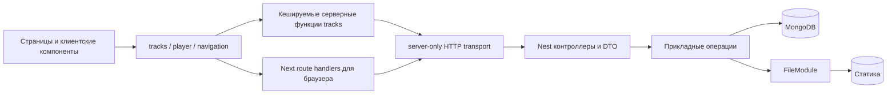

# Gurach: архитектурный разбор и план изменений

Дата: 2026-11-08. Разбор текущих исходников; наличие данных в работающей MongoDB не проверялось.

## Решение об архитектуре

Сохранить два приложения: Next.js как интерфейс и BFF, NestJS как модульный монолит с бизнес-операциями. MongoDB и локальная статика соответствуют текущему масштабу. Микросервисы, отдельный брокер событий, универсальный repository поверх Mongoose и глобальная библиотека состояния сейчас увеличат стоимость сопровождения без установленной потребности.

Улучшать границы и контракты по сценариям. Переносить код в новые слои только при появлении ответственности, которую можно назвать и проверить отдельно.

Важное различие: API_URL — адрес Nest, доступный процессу Next, а PUBLIC_URL — адрес медиа, доступный браузеру. В контейнерном окружении они могут различаться.

## Изменения, выполненные в этой итерации

1. TrackModule импортирует FileModule и получает экспортируемый FileService через DI. Удалена повторная регистрация FileService и лишний импорт FileModule в AppModule.
2. server-only транспорт `client/lib/server/backend.ts` централизует адрес API, таймаут и обработку ответов прокси. Функции фич сохраняют владение кешированием; внутренний fetch не создаёт второй постоянный кеш.
3. BFF сохраняет статусы 4xx и Retry-After, скрывает подробности серверных ошибок и ограничивает ожидание upstream. GET списка передаёт count/offset. Идентификаторы кодируются как отдельный сегмент URL.
4. getTrack возвращает null только для неправильного формата ID и настоящего 404. Сбой Nest больше не маскируется под отсутствующий трек. Обе функции чтения имеют cache tags; для основного layout добавлена error boundary с повтором.
5. Listen endpoint возвращает `{ listens }` после атомарного инкремента. Клиент показывает подтверждённое серверное значение, учитывает порядок ответов через максимум и не заменяет накопленный счётчик числом 1. Неуспешный POST не меняет экран. Страница трека использует тот же источник живых значений, что и список.
6. Плеер считает выбор трека отдельной сессией: пауза не создаёт новый запрос, возврат к треку после смены выбора создаёт. При переходе сбрасывается время, треки без audio пропускаются. Ошибка audio сбрасывает индикатор воспроизведения.
7. ListenCountsProvider перенесён из провайдера визуальной темы в основную оболочку приложения. Тема больше не управляет предметным состоянием.
8. Кнопка воспроизведения стала соседней со ссылкой на название: удалена вложенность button внутри anchor.
9. Пагинация Nest принимает только безопасные целые числа и использует стабильную сортировку по _id. Предел count сохранён: 100; значение по умолчанию для списка: 10.
10. Удаление медиа ожидается, ошибки удаления и компенсации создания логируются. Это наблюдаемая компенсация, а не гарантия транзакции между диском и MongoDB.
11. ESLint исключает вложенные каталоги .next: в рабочем дереве обнаружен client/client/.next с сгенерированным кодом.
12. Добавлены изолированные unit-тесты границ пагинации и атомарного listen-контракта. Они не заменяют интеграционные тесты MongoDB и браузерные проверки.

## Приоритет 1: доступ и целостность данных

### Авторизация операций записи

POST трека/комментария и DELETE трека/комментария публичны. Login — только заголовок. CORS не ограничивает curl и серверные запросы; rate limit не задаёт права.

Перед публичным размещением выбрать провайдера аутентификации и модель прав. Nest должен проверять сессию/токен и право владельца либо администратора на удаление. Next отвечает за UX сессии, Nest — за окончательное разрешение операции. Клиентские скрытые кнопки не являются проверкой прав. Username комментария должен происходить из подтверждённой личности, если продукт требует авторства.

Требуются новые данные userId/ownerId и явное правило для старых треков. Без этого добавление auth guard сделает существующие записи бесхозными. При cookie-аутентификации отдельно определить CSRF-защиту для мутаций.

### Комментарии: одна связь вместо двух

Сейчас связь одновременно хранится в Comment.track_id и Track.comments. Создание и удаление требуют нескольких Mongo-запросов. Сбой второго запроса и конкурентное удаление трека могут оставить связи и документы несогласованными. Массив comments растёт вместе с обсуждением; список треков выполняет populate всех комментариев.

Целевая модель: Comment.track_id — единственный источник связи, индекс `{ track_id: 1, _id: 1 }`; комментарии читаются отдельным запросом с курсором. TrackListItem не содержит комментариев, TrackDetail не загружает их без ограничения. Отдельный CommentsModule становится владельцем DTO/схемы/сервиса, когда сценарии комментариев будут реализованы в UI.

Переход: найти расхождения обеих сторон связи, определить судьбу orphan comments, восстановить track_id там, где это однозначно, добавить индекс, переключить чтение, затем убрать массив из схемы и отдельной миграцией из старых документов. Не удалять массив до сверки: старые данные могут зависеть от него.

Даже одна связь не решает гонку «создать комментарий / удалить трек». Для строгой гарантии использовать транзакции MongoDB на replica set, согласованную операцию блокировки/soft delete трека либо сверку orphan comments с заданной допустимой задержкой. Текущий Compose не настраивает replica set.

### Файлы и MongoDB

Сейчас создание файла компенсируется удалением при ошибке записи документа. Но завершение процесса между этими действиями оставляет сироту. Удаление сначала удаляет документ, затем комментарии и медиа; сбой после первого шага уже нельзя безопасно повторить по тому же endpoint.

Целевой процесс удаления: пометить трек как deleting, скрыть из чтения, выполнить повторяемую очистку комментариев и файлов, удалить документ после успешной очистки. Для малого проекта достаточно команды сверки/очистки и логирования; фоновую очередь вводить при необходимости гарантированных повторов. Хранить disk/object storage за текущим FileModule, пока единственной реализации достаточно.

## Приоритет 2: функциональность и контракты

### Каталог действительно показывает первую страницу

getTracks запрашивает /tracks без параметров; Nest по умолчанию возвращает 10. Поэтому интерфейс «Список всех треков» не представляет весь каталог. Нельзя исправить это бесконечной выгрузкой или просто count=100.

Целевой ответ списка: `{ items: TrackListItem[], nextCursor: string | null }`. Курсор по стабильному ключу _id; индекс MongoDB _id уже есть. Для обратной совместимости сначала можно добавить версию endpoint или согласованно обновить оба приложения. UI должен поддерживать «Загрузить ещё» или страницы; очередь плеера включает явно загруженные треки. Total нужен только если его требует интерфейс: countDocuments имеет собственную стоимость.

### Разделить read и write контракты

Сейчас ITrack рукописный, комментарии обязательны, duration из схемы не отражён в клиентском типе. Search не делает populate, в отличие от getAll/getOne: одинаковое имя comments обозначает то документы, то ObjectId. Нужны TrackListItem, TrackDetail, Comment и ListenResult с определёнными полями.

Для Mongo оставить текущие имена до миграции; наружу выдавать DTO через явный mapper. Сериализация в schema.toJSON удобна сейчас, но зависит от hydrated documents; переход к lean() обойдёт эти transform и сломает URLs/lyrics. Mapper должен принимать plain data и использовать конфигурацию медиа отдельно от модели БД.

OpenAPI на Nest и генерация клиентских типов предпочтительнее ручного синхронного сопровождения. Общий пакет контрактов тоже допустим, если не импортирует Nest/Mongoose в Next. Пока не нужно превращать проект в workspace только ради нескольких типов.

### Загрузка и комментарии в UI

/upload содержит file input без формы, полей name/picture и отправки. Кнопка «Добавить комментарий» ведёт на #. Реализовать эти сценарии после решения о доступе: UI формы, pending/ошибки полей, Server Action либо route handler с явным multipart-проксированием, успешное обновление кеша. Сохранять ограничения файлов на Nest даже при проверке браузером.

duration приходит из multipart как строка, а DTO ожидает число при выключенной implicit conversion. Нужна явная контролируемая конверсия, минимум 0, либо вычисление длительности из аудио на сервере. Текстовые поля должны trim-иться и иметь пределы длины; whitespace-only name/username сейчас проходит IsNotEmpty. Не включать глобальную неявную конверсию ради одного поля.

## Приоритет 3: надёжность API и конфигурации

### Ограничения загрузки

FileService выбирает расширение по originalname, неизвестное заменяет defaultExt. Это не проверка содержимого. Нужны проверка разрешённого формата, сигнатур изображения/аудио и согласованность расширения. MIME из запроса также нельзя считать доказательством. При необходимости отдельно ограничить размеры изображения и длительность медиа.

Multer хранит до двух файлов по 50 МБ в памяти на запрос. Для нескольких одновременных загрузок это заметное потребление RAM. Перейти к временному файлу/потоку, если ожидаются большие медиа или параллельные загрузки. Для production определить persistent volume, резервное копирование и правила обслуживания Range-запросов.

### Rate limit за BFF

Для Nest источником многих запросов будет IP Next-сервера. Значит лимит прослушиваний может стать общим для пользователей. Теперь 429 и Retry-After доходят до браузера, но идентификация клиента по-прежнему требует решения.

Не пересылать произвольный X-Forwarded-For как доверенный. Настроить известную цепочку reverse proxy, закрыть обход доверенного ingress и определить tracker по пользователю/сессии плюс IP. In-memory rate limit не суммируется между экземплярами Nest; общий store нужен при горизонтальном масштабировании.

### Env и локальный запуск

Compose включает авторизацию MongoDB с dev-кредами, а default URI Nest не содержит кредов. README-обещание запуска без env не соответствует чистому запуску такого Compose. Нужен согласованный dev-набор в шаблонах и точная инструкция копирования. На существующем volume изменение MONGO_INITDB_* не меняет уже созданные аккаунты.

UPLOAD_MAX_MB, TTL и throttle limits проверяются на целочисленность, но не на положительность. Также нужны проверки протоколов URL и понятные сообщения о некорректных настройках. Ввести env-схему либо расширить текущие маленькие функции. Не логировать Mongo URI с паролем.

## Приоритет 4: состояние интерфейса и кеширование

### Границы плеера

PlayerProvider сейчас владеет и транспортом audio, и очередью, и прогрессом, и интеграцией учёта. Его value меняется на каждый timeupdate; все usePlayer-потребители, включая строки каталога, получают обновление.

Следующий шаг при росте списка: вынести player в features/player; разделить контекст команд, состояние выбора/playing и часто обновляемый progress. При необходимости вынести управление audio в хук с проверяемым переходом selection -> loading -> playing/paused/error/ended. До этого отдельный Redux/Zustand не обязателен.

Уточнить продуктовые правила: что считается прослушиванием (теперь старт, а не порог длительности), когда повторный старт считается новым, что происходит на границе очереди. Текущий ref защищает только от повторного события в рамках одной вкладки, а не от накрутки и повторов доставки. Для идемпотентности отправлять session ID и дедуплицировать на сервере. Автоматические повторы POST без такого ID могут удвоить инкремент.

Плеер живёт только в (main); переход в /login размонтирует его. Поднять выше лишь если воспроизведение должно продолжаться во время входа. Добавить пользователю видимое состояние ошибки audio и проверить клавиатуру, autoplay, реальные форматы и мобильный браузер.

### Кеш

Сейчас feature read functions владеют кешем Next, транспорт делает no-store. Теги tracks и track:<id> позволяют связать инвалидирование с будущими мутациями. После загрузки/удаления инвалидировать список и нужную деталку; после комментария — деталку/комментарии.

Прослушивание не обязано инвалидировать весь каталог на каждый старт: подтверждённый клиентский счётчик и периодическое серверное обновление достаточны для текущей модели. Значение монотонно в текущем UI; если понадобится административный сброс счётчика, нужно сбрасывать и клиентский store.

Кешируемый список может запрашиваться при next build. Это связывает сборку с доступностью API. Для независимой сборки перенести получение данных за request-time Suspense/connection boundary; это осознанное решение о prerender, а не подавление исключения и кеширование пустого списка.

### UI и навигация

Navbar — автономная декоративная навигация; её не нужно смешивать с моделями треков. Переименовать trackStructure/TrackItem в navigationStructure/NavigationItem, чтобы не путать с музыкальными треками. Сейчас hover-эффекты не дают равноценного поведения клавиатуре/тачу; активный маршрут не отмечен. BackButton проверяет общую историю браузера, поэтому back может увести на внешний сайт; определить ожидаемое правило возврата.

Палитра продублирована в globals.css и MUI theme; при изменении дизайна нужен один источник токенов. CSS ссылается на Geist, но layout не подключает next/font. Tailwind loader присутствует, хотя в просмотренном UI стили задаются через MUI sx: удалить Tailwind после проверки реальной необходимости и сборки.

## Репозиторий и эксплуатация

В Git отслеживаются 16 275 файлов корневого node_modules. Правило .gitignore не убирает уже отслеживаемые файлы. Есть локальные изменения зависимостей и удалённые корневые package.json/package-lock.json. Это нужно разбирать отдельной операцией с сохранением нужных патчей, а не удалять каталог во время рефакторинга.

Цель: Git хранит исходники и lock-файлы; воспроизводимая установка через npm ci. Если патчи зависимостей необходимы, оформить их как воспроизводимые patch-файлы с объяснением. Изолировать runtime media от исходников и выбрать, какие демонстрационные assets действительно нужны в репозитории.

mongo:latest сделать фиксированной поддерживаемой версией после проверки совместимости и восстановления backup. Добавить CI для npm ci, lint, typecheck, unit tests и build. Нужны health/readiness, корректное завершение приложения и структурированные логи; импортированный пакет наблюдаемости сам по себе не означает, что AppModule его подключает.

## Порядок дальнейших работ

1. Согласовать dev-конфигурацию MongoDB, env-валидацию и воспроизводимую установку зависимостей.
2. Определить роли/права и реализовать серверную авторизацию записи/удаления.
3. Согласовать read DTO и пагинацию; сделать доступным весь каталог без populate комментариев.
4. Реализовать формы загрузки/комментария с серверной валидацией и инвалидированием кеша.
5. Мигрировать комментарии к одному источнику связи, реализовать повторяемое удаление/очистку.
6. Разделить контексты плеера и проверить браузерные сценарии.
7. Перед размещением: persistence/backup, доверенные proxy, shared rate limit при нескольких экземплярах и CI.

Большие миграции выше намеренно описаны отдельно от выполненных изменений: они требуют явных правил для существующих данных и интеграционных проверок.

## Проверка этой итерации

- Nest build и lint завершились успешно.
- Client ESLint завершился успешно после исключения вложенного .next; TypeScript проверялся отдельно без emit.
- Vitest: 1 файл, 11 успешных проверок; изолированные mocks, без работающей MongoDB.
- Next production build не завершён: Turbopack падает на обработке globals.css с `binding to a port / Operation not permitted`. Повтор с разрешённым запуском вне sandbox дал ту же ошибку.
- Nest API на localhost:5000 во время проверки не отвечал. Проверки с реальной БД, прослушивания в браузере и полной цепочки BFF -> Nest не выполнялись.
- В рабочем дереве до начала этой итерации уже были изменения исходников, конфигурации и зависимостей. Они сохранены; статистика общего git diff включает их вместе с этой работой.
